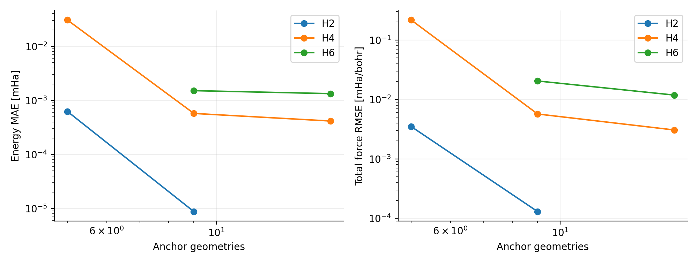

# Abstract

We investigate geometry-conditioned neural wavefunctions by solving finite-basis electronic Hamiltonians rather than regressing prescribed potential energies. A from-scratch implementation evaluates hydrogen STO-3G integrals, assembles fermionic Hamiltonians, and optimizes signed neural configuration-interaction coefficient maps with exact configuration sums. Independent PySCF calculations validate the integral and Hamiltonian construction. Experiments span H$_2$, H$_4$, and H$_6$ stretching paths and a two-coordinate H$_4$ surface, with exact full configuration interaction as the reference. On unseen H$_4$ chain geometries, a nine-anchor model achieves mean energy error $5.73\times10^{-4}$ mHartree and total generalized-force RMSE $5.69\times10^{-3}$ mHartree/bohr over three seeds. Holding its coefficients fixed during differentiation produces substantially larger force errors. A two-coordinate H$_4$ model improves from 2.52 to 0.0253 mHartree/bohr force RMSE when the anchor grid increases from nine to 25 geometries. Orbital-rotation controls show that total derivatives are invariant for a fixed physical state while the coefficient-response decomposition is chart dependent. A constructed oscillatory-state example demonstrates that small variational energy errors alone cannot bound derivative errors. Simple coefficient interpolation remains a strong baseline; response penalties and longer optimization do not uniformly improve forces. The study isolates derivative reliability in small electronic spaces and does not claim a scalable neural quantum-state architecture, complete-basis accuracy, or a new general method for orbital alignment.

# 1. Introduction

Learning a potential from energies and forces and learning an electronic wavefunction are different computational problems. In the first, a reference method supplies labels that define the target surface. In the second, the Hamiltonian defines a variational objective and the wavefunction is optimized directly. The second route preserves access to electronic observables and makes the relationship between nuclear geometry, electronic correlation, and energy derivatives explicit.

This report pursues the latter route. The preceding project established energy-derived force learning on analytic hydrogen curves and molecular reference data. Here the hydrogen systems are no longer generated by a Morse formula: their energies arise from one- and two-electron integrals in a stated orbital basis. The neural model represents a geometry-dependent many-electron state, and full configuration interaction (FCI) provides an exact reference within that basis.

Geometry-conditioned wavefunctions and shared optimization across molecular structures are already established research directions [1–4]. In particular, a recent preprint by Fu and collaborators treats geometry-conditioned second-quantized neural states and explicitly addresses orbital alignment [4]. Consequently, this report does not claim that sharing a neural wavefunction across geometries, or choosing a consistent orbital representation, is new. Its narrower purpose is to make derivative reliability experimentally and mathematically transparent in a setting where all electronic states and numerical errors can be inspected.

Three questions organize the study. First, how accurately does energy-only variational training interpolate a family of electronic states? Second, when is differentiating the complete geometry-conditioned energy materially different from differentiating the Hamiltonian at fixed neural coefficients? Third, which apparent improvements survive controls for orbital chart, anchor placement, model width, and optimization budget?

The resulting picture is mixed and useful. Smooth shared coefficient models perform very well on the simple stretching manifolds. Their total derivatives are generally more accurate than their fixed-coefficient derivatives, and their one-electron observables track the exact finite-basis reference. A more demanding two-coordinate surface requires substantially more anchors. Artificially twisted orbital coordinates make the same state family difficult to learn. Increasing optimization or penalizing the coefficient-response term does not provide a universal improvement. Finally, a classical interpolation of exact anchor wavefunctions is competitive, preventing an unsupported claim that the neural representation is essential in these small systems.

# 2. Background and related work

## 2.1 Neural electronic states across molecular geometries

Choo, Mezzacapo, and Carleo demonstrated fermionic neural states for finite-basis electronic structure [1]. Scherbela and collaborators studied shared neural-wavefunction parameters across molecular geometries [2], while Gao and Günnemann's PESNet combines a graph network with neural wavefunctions to address molecular potential-energy surfaces [3]. These approaches motivate joint optimization over nuclear configurations rather than repeated independent optimization.

The recent second-quantized approach of Fu and collaborators uses geometry and aligned orbital descriptors to condition a wavefunction model [4]. It is a preprint, and its reported performance is not independently reproduced here. Our implementation differs substantially: it enumerates the full determinant sector and produces its coefficient vector with a small dense network. It provides a controlled finite-dimensional experiment, not a competing large-scale architecture. The main comparisons below are internal numerical controls and exact small-system references.

## 2.2 Energy derivatives and moving orbital bases

Electronic force calculations must account for the dependence of both the state and the orbital representation on nuclear geometry. Basis-motion terms are a longstanding issue in quantum chemistry [5]. It is therefore unsafe to describe an arbitrary derivative at fixed numerical coefficients as the physical Hellmann–Feynman force.

Our construction differentiates the entire finite-basis Hamiltonian after orthogonalization. Its matrix derivative includes changes in atomic integrals, the nuclear repulsion, and the orthogonalization map. An additional term comes from the geometry dependence of the learned coefficient vector. These two pieces are well-defined in a chosen smooth orbital chart, but their separate values can change under a geometry-dependent orbital rotation. Their sum is the derivative of the scalar variational energy and is invariant when the same state is transformed consistently.

## 2.3 Exact small systems as a diagnostic setting

Exact summation removes Monte Carlo noise from this study. FCI also provides energies, state overlaps, excitation gaps, and reduced density matrices without stochastic estimation. This makes it possible to isolate representation and optimization effects before addressing the sampling problems relevant to scalable neural quantum states.

The price is exponential scaling. With $M$ spatial orbitals and $N_\alpha=N_\beta=M/2$, the determinant dimension is

$$D={M\choose M/2}^2.$$

For the systems studied, $D=4$, 36, and 400. Both dense Hamiltonian storage and the neural coefficient readout depend on $D$. Numerical success at these sizes does not establish a route around the exponential many-electron problem.

# 3. Electronic-structure methods

## 3.1 Hamiltonian, basis, and units

All calculations use atomic units: energies in Hartree and lengths in bohr. Each hydrogen atom carries one contracted STO-3G $s$ orbital. The normalized primitive exponents are 3.425250914, 0.6239137298, and 0.1688554040, with contraction coefficients 0.1543289673, 0.5353281423, and 0.4446345422. The finite precision of these constants contributes small differences relative to a library basis definition.

For clamped nuclear positions, the electronic Hamiltonian including nuclear repulsion is

$$\hat H=E_{\rm nuc}+\sum_{pq\sigma}h_{pq}a^\dagger_{p\sigma}a_{q\sigma}
+\frac12\sum_{pqrs\sigma\tau}(pq|rs)
 a^\dagger_{p\sigma}a^\dagger_{r\tau}a_{s\tau}a_{q\sigma}.$$

The implementation computes overlap, kinetic, nuclear-attraction, and electron-repulsion integrals directly from Gaussian product formulas. The only special function required is the error function entering the order-zero Boys function. No quantum-chemistry library is used to generate training Hamiltonians or FCI reference matrices.

Let $S$ denote the atomic-orbital overlap matrix. Symmetric orthogonalization uses $X=S^{-1/2}$, giving $h^{\perp}=X^ThX$ and the corresponding four-index transformation of the Coulomb tensor. Site labels define the orbital ordering throughout each smooth geometry family. We do not introduce independently diagonalized molecular orbitals at every geometry.

The fixed-electron-number, fixed-$S_z=0$ determinant basis uses all alpha occupations followed by all beta occupations. Fermionic creation and annihilation operators are applied to bit strings, with signs counted from occupied lower-index spin orbitals. No assumption that coefficients are positive is made. Antisymmetry is encoded by the determinant basis, while total spin $S^2$ is not imposed on the network.

## 3.2 Reference solution and independent validation

The reference energy $E_0(q)$ and coefficient vector $c_0(q)$ are obtained by dense symmetric diagonalization of the independently assembled Hamiltonian. “Exact” throughout this paper means exact in the stated finite orbital space and electron-number sector; it does not mean the complete-basis electronic solution or an experimentally exact potential.

PySCF [6] is used only for independent validation. At four H$_2$/H$_4$ geometries, atomic integrals are compared with its integral engine. Its FCI solver is also supplied our transformed integrals to check the independent fermionic matrix assembly. Componentwise integral agreement and FCI agreement test complementary implementation stages. Restricted Hartree–Fock (RHF) values at these same points provide an additional check.

A separate scratch RHF implementation uses a closed-shell density and Pulay DIIS. It does not converge at every H$_4$ grid point: 21 of 209 points reach its 500-step limit. Accordingly, unconverged RHF values are excluded from the illustrative energy curve, and the full RHF force curve is not used as a quantitative baseline. The neural/FCI results do not depend on RHF convergence; neural initialization uses core-Hamiltonian orbitals, not an RHF solution.

## 3.3 Nuclear paths and generalized forces

Uniform chains use positions

$$R_i(q)=(iq,0,0),\qquad i=0,\ldots,N-1.$$

H$_2$ and H$_4$ reference grids contain 209 points on $[0.8,6]$ bohr. H$_6$ uses 81 points on $[1,5]$ bohr. Training anchors are uniformly spaced on $[1,5]$. Query points inside this interval exclude every training anchor; compressed and stretched extrapolation are scored separately where available.

The two-coordinate H$_4$ family is collinear but nonuniform:

$$R(a,b)=\{0,a,a+b,2a+b\}\hat x.$$

Both outer bonds have spacing $a$ and the central spacing is $b$. The reference set is the Cartesian product of 13 uniformly spaced values on $[1,4]$ plus the two exterior values 0.8 and 4.4, giving 225 geometries. Training grids contain $3\times3$, $5\times5$, or $7\times7$ interior anchors. Unseen interior geometries and exterior configurations are evaluated separately.

The reported force is the generalized force $Q_q=-dE/dq$, or the vector $(Q_a,Q_b)$. For a uniform chain, $Q_q=\sum_i iF_{ix}$. Thus it is a collective derivative and must not be compared directly with the Cartesian force-component MAE of an atomistic benchmark. On the two-coordinate family, $Q_a$ and $Q_b$ are the corresponding linear combinations of nuclear forces. No complete three-dimensional Cartesian-force benchmark or nuclear trajectory is claimed.

## 3.4 Hamiltonian derivatives

Final one-coordinate force references use the five-point stencil

$$H'(q)\simeq\frac{-H(q+2h)+8H(q+h)-8H(q-h)+H(q-2h)}{12h},\qquad h=10^{-3}\ {
m bohr}.$$

Two-coordinate references use centered differences with $h=10^{-4}$ bohr. Every displaced Hamiltonian is recomputed from its atomic integrals and orthogonalization, rather than differentiating only the nuclear attraction term. Independent step-size and direct energy-difference checks assess numerical stability. Initial exploratory runs used centered derivatives; all final one-coordinate metrics and saved curves are rescored with the five-point reference.

# 4. Neural state and variational optimization

## 4.1 Geometry-conditioned signed coefficient map

The one-coordinate model is

$$v_\theta(q)=\tanh(Ax+b)W+d,\qquad x=(q-3)/2,$$

$$c_\theta(q)=v_\theta(q)/\|v_\theta(q)\|,\qquad
\mathcal E_\theta(q)=\frac{v_\theta^TH(q)v_\theta}{v_\theta^Tv_\theta}.$$

Here $v$ has $D$ real, signed components. The standard widths are 12 for H$_2$ and 24 for H$_4$/H$_6$; H$_4$ width controls also use 8 and 48. The two-coordinate network uses $x=((a-2.5)/1.5,(b-2.5)/1.5)$ and width 32. A separate network is trained for each atom number. There is no learned transfer between H$_2$, H$_4$, and H$_6$.

The output bias starts from a normalized closed-shell determinant formed from the core one-electron Hamiltonian at the midpoint spacing. Small random output weights and random hidden weights use seeds 0, 1, and 2. This initialization requires no FCI state or energy labels. Geometry dependence enters through the neural input, and all coefficients are optimized jointly across anchors.

The variational loss is

$$\mathcal J(\theta)=\frac1K\sum_{k=1}^K\mathcal E_\theta(q_k)+10^{-10}\|\theta\|^2.$$

FCI energies, FCI coefficients, forces, and density matrices are not training targets. The very small parameter penalty weakly controls scale redundancy. The Rayleigh quotient itself remains a variational energy at every query, whether or not that geometry was used for optimization.

## 4.2 Manual derivatives and budgets

We implement forward geometry tangents and reverse parameter derivatives algebraically with NumPy. For an unnormalized vector $v$,

$$\nabla_v\mathcal E=\frac{2(H-\mathcal E)v}{v^Tv}.$$

The hidden-layer derivative uses $d\tanh(z)/dz=1-\tanh^2(z)$. Mixed derivatives needed for the response-penalty control are also coded explicitly. Central parameter differences validate the implementation. No automatic-differentiation or high-level neural-network framework is used.

L-BFGS-B uses a maximum of 1,800 iterations for the main one-coordinate fits, 2,500 for the two-coordinate fits, and 7,200 for a longer-budget control. All seeds are retained, and unsuccessful termination statuses are reported. Most fits reach the specified cap. These are finite-budget variational fits rather than demonstrations of converged global optima. Runtime is small because the spaces and geometry batches are small; it provides no evidence of favorable asymptotic scaling.

# 5. Force response and orbital-chart analysis

## 5.1 Exact derivative decomposition

For a normalized real coefficient vector $c(q)$, define the electronic residual

$$r=(H-\mathcal E)c.$$

The derivative identity is

$$\mathcal E'=c^TH'c+2(c')^Tr.$$

We call $c^TH'c$ the fixed-coefficient derivative and $2(c')^Tr$ the coefficient-response term. The total generalized force is the negative of their sum. For an exact nondegenerate eigenstate, $r=0$ and the coefficient-response term vanishes in any smooth chart. For an approximate state, it generally does not.

The derivative of $c$ includes normalization. Its component parallel to $c$ vanishes for a normalized real vector; equivalently, only $c'_\perp$ matters because $c^Tr=0$. A small energy error is second order in eigenstate contamination, whereas derivatives can involve additional variation of that contamination across geometry. This is why a variational upper bound on the energy is not a derivative-accuracy guarantee.

## 5.2 A reference-assisted derivative bound

Assume the lowest eigenvalue of the finite matrix is nondegenerate with gap $\Delta=E_1-E_0>0$. Write $\delta E=\mathcal E-E_0$. Spectral decomposition gives

$$1-|c_0^Tc|^2\le\min(1,\delta E/\Delta).$$

Combining this with the trace-distance bound on expectation values and Cauchy–Schwarz yields

$$|\mathcal E'-E_0'|\le
2\|H'\|_{\rm op}\sqrt{\min(1,\delta E/\Delta)}
+2\|r\|\,\|c'_\perp\|.$$

The first term bounds the difference between the fixed-coefficient expectation and the exact reference derivative; the second bounds coefficient response. Appendix A provides the short derivation. This elementary finite-dimensional bound is not claimed as a new theorem. It is a useful way to identify the information omitted by an energy-only error report.

The numerical bound below uses exact $E_0$ and the exact gap. It is therefore a reference-assisted diagnostic, not an operational error certificate for a system whose ground state is unknown. In addition, operator norms and state speed can make it very loose. The speed and decomposition refer to a specified orbital chart; they are not automatically continuum nonadiabatic-coupling observables.

## 5.3 A controlled oscillatory-state example

Let $c_0(q)$ and $c_1(q)$ be normalized lowest eigenstates, and construct

$$\widetilde c(q)=\cos\alpha(q)c_0(q)+\sin\alpha(q)c_1(q),\qquad
\alpha(q)=\epsilon\sin(\omega q).$$

Its energy error is exactly $\sin^2\alpha\,\Delta$, while the derivative error is

$$\delta E'=\sin(2\alpha)\alpha'\Delta+\sin^2\alpha\,\Delta'.$$

At fixed small $\epsilon$, the energy-error envelope is bounded independently of $\omega$, but its derivative can grow with frequency. We evaluate this control using the lowest eigenvalues of a cubic interpolation of the dense H$_4$ reference Hamiltonians, with $\epsilon=0.02$ and $\omega=1,10,100$ bohr$^{-1}$. The gap derivative is obtained from the eigenvectors and the derivative of that interpolated Hamiltonian. This is a constructed exact-state control, not a trained neural prediction or a claimed typical failure rate.

## 5.4 Orbital-chart transformation

For a geometry-dependent orthogonal transformation $W(q)$ on determinant coefficients,

$$H_g=W^THW,\qquad c_g=W^Tc.$$

Then $\mathcal E_g=\mathcal E$ and the total derivatives agree. However,

$$H_g'=W'^THW+W^TH'W+W^THW'$$

contains chart-rotation terms. The response derivative changes in compensation. Defining $\mathcal A=W^TW'$, one can write the relative-chart covariant derivatives

$$D_qc_g=c_g'+\mathcal A c_g,\qquad
D_qH_g=H_g'+[\mathcal A,H_g].$$

These transform the chosen smooth-chart derivatives consistently. They describe the controlled coordinate change used here, not a complete treatment of the connection of moving atomic subspaces in continuum electronic Hilbert space.

The experiment rotates the first two orthonormal spatial orbitals by $\vartheta(q)=3\pi(q-1)/4$ and lifts that rotation to determinants through exterior-product minors. All alpha and beta determinant transformations are included. This leaves every exact energy unchanged. We distinguish transforming one fixed approximate physical curve, which must preserve its derivative, from training a new neural model directly in the twisted chart, which is a different approximation problem.

# 6. Experimental controls

The main learning curves vary the number of anchor geometries, model width, and seed. Anchor coordinates are fixed in advance. No FCI validation loss is used to select the reported main model. Interior errors exclude anchors, while exterior points test a genuinely different geometry range. Means and population standard deviations across three seeds describe initialization variation; they are not confidence intervals or estimates of Monte Carlo uncertainty.

Two classical baselines use nine exact FCI anchors. A cubic energy spline interpolates scalar energies and is differentiated directly. A coefficient spline first aligns successive anchor-vector signs by overlap, interpolates their components, normalizes the result, and evaluates the Rayleigh quotient with the query Hamiltonian. The latter is variational but requires the full exact anchor wavefunctions; it is consequently an information-rich baseline, not an equal-cost comparison to fitting nine scalar energy labels. It is valuable precisely because the state manifolds are small and smooth.

A response-penalty control adds $\lambda\langle[2(c')^Tr]^2\rangle$ to the anchor objective, using $\lambda=1$ or 10 in the stated atomic-unit convention. The term needs no reference force labels, but is chart dependent. We test it as a proposed regularizer that may fail, not as an established physical constraint.

A final collocation study compares uniform insertion, random insertion, largest electronic residual norm, and largest absolute coefficient response. Each starts from anchors at 1, 2, 3, 4, and 5 bohr, then adds two geometries twice. Three warm-started stages each allow 600 iterations, giving nine final anchors and a total nominal budget of 1,800 iterations. All candidates are selected from the same known Hamiltonian grid, with minimum separation greater than 0.15 bohr from selected points. Every insertion rule is evaluated on the same independent 160-point midpoint query grid, disjoint from all candidate and training geometries. The adaptive methods require Hamiltonian access at candidate geometries. No saving in integral-generation or electronic-structure labeling cost is inferred.

# 7. Results

## 7.1 Independent validation and correlated electronic reference

\needspace{12\baselineskip}
**Table 1. Independent validation.** Integral errors are maximum absolute elementwise differences from PySCF. The FCI assembly error compares two solvers using our transformed integrals. Energies and integral errors are in atomic units.

|System|Spacing|FCI energy|Max integral error|FCI assembly error|
|---|---|---|---|---|
|H2|1.4|-1.137275944|1.64e-09|8.882e-16|
|H2|4.0|-0.943778473|3.004e-09|2.22e-16|
|H4|1.4|-2.139442551|5.143e-09|3.997e-15|
|H4|3.0|-1.970869761|4.196e-09|2.442e-15|

The largest componentwise integral discrepancy is approximately $5.2\times10^{-9}$, while the FCI assembly differences are below $4.1\times10^{-15}$ Hartree at the validated geometries. RHF energies there agree within approximately $2.1\times10^{-9}$ Hartree. Integral validation and many-body assembly validation are both necessary: agreement of two solvers supplied the same integrals alone would not validate those integrals.

At H$_4$ spacing 3 bohr, FCI gives $-1.970869761$ Hartree and RHF gives approximately $-1.779172569$ Hartree. This large finite-basis correlation contribution makes clear that the task extends beyond fitting an analytic bond curve. The restricted reference is a single closed-shell determinant; the FCI state includes electronic configurations needed in the stretched regime. It is nevertheless a minimal-basis hydrogen problem, not a quantitative prediction for general molecular chemistry.

The exact fixed-$S_z$ gaps decrease strongly upon stretching. Their minima over the full stored paths are about $3.50\times10^{-4}$, $2.31\times10^{-4}$, and $1.29\times10^{-3}$ Hartree for H$_2$, H$_4$, and H$_6$, respectively. Near such small gaps, energy closeness is a weaker constraint on state fidelity. The neural state is not explicitly restricted to total spin zero, so spin contamination is checked rather than assumed absent.

## 7.2 Shared-state interpolation across stretching

\needspace{12\baselineskip}
**Table 2. Unseen interior queries for the main neural models.** Values are seed means with population standard deviations in parentheses. Energy errors are in mHartree; generalized-force RMSEs are in mHartree/bohr. Widths are 12 for H$_2$ and 24 otherwise. Every fit has a 1,800-iteration budget.

|System|Anchors|Queries|Energy MAE|Total force|Fixed-coeff. force|
|---|---|---|---|---|---|
|H2|5|156|0.000624 (0.00036)|0.00349 (0.0021)|0.217 (0.081)|
|H2|9|152|8.77e-06 (2.7e-06)|0.00013 (1e-05)|0.0245 (0.0041)|
|H4|5|156|0.0306 (0.014)|0.217 (0.069)|2.14 (0.37)|
|H4|9|152|0.000573 (3.4e-05)|0.00569 (0.00068)|0.112 (0.017)|
|H4|17|144|0.000415 (3.5e-05)|0.00306 (0.00054)|0.107 (0.0095)|
|H6|9|72|0.00151 (8.8e-05)|0.0204 (0.00057)|0.182 (0.098)|
|H6|17|64|0.00133 (0.00049)|0.0118 (0.0022)|0.137 (0.038)|

The H$_2$ family is extremely smooth in this representation. H$_4$ is more demanding at five anchors, but nine anchors already reduce both energy and total-force errors substantially. Increasing to 17 anchors improves the mean total-force error further, although not by a universal power law. H$_6$ increases the electronic sector from 36 to 400 determinants and retains low interpolation errors, without establishing useful scaling beyond this small benchmark.

Fixed-coefficient force errors are consistently larger than total derivative errors in the main models. The omitted response is not simply an extra source of noise: it often cancels the leading error of the fixed-coefficient expectation. Consequently, discarding it because the variational energy is small is unjustified. The relevant stationarity condition would be stationarity with respect to the coefficient vector at every query geometry, not merely minimization of an aggregate neural-parameter objective at the anchors.

{width=100%}

{width=95%}

## 7.3 Electronic observables and spin checks

The spin-summed one-electron density matrix is evaluated without observable labels. Its natural occupations evolve from near closed-shell values toward more fractional occupations as the chain stretches. The shared network follows that evolution in the representative H$_4$ model, showing that it approximates an electronic state rather than only a scalar energy.

\needspace{10\baselineskip}
**Table 3. One-electron observable errors for representative nine-anchor, seed-zero models.** The density-matrix error is the mean Frobenius norm over unseen interior queries. Trace and Hermiticity checks cover the full stored curve.

|System|Mean density-matrix error|Maximum trace error|
|---|---|---|
|H2|0.000218|8.882e-16|
|H4|0.001066|1.776e-15|
|H6|0.0007215|5.329e-15|

The density matrices are Hermitian to printed numerical precision and retain the correct electron number. Maximum interior $\langle S^2\rangle$ deviations in the representative models are approximately $2.4\times10^{-7}$, $5.8\times10^{-7}$, and $2.4\times10^{-6}$ for H$_2$, H$_4$, and H$_6$. Exact reference values are at numerical zero. These checks are limited to the selected fits and do not prove that unconstrained spin is harmless in more strongly frustrated or near-degenerate problems.

## 7.4 A genuinely two-coordinate state family

\needspace{12\baselineskip}
**Table 4. Two-coordinate H$_4$: unseen interior geometries.** Each network has width 32 and a 2,500-iteration budget. Units and seed summaries follow Table 2; force errors average both generalized-force components.

|Anchors|Unseen queries|Energy MAE|Total force RMSE|Fixed-coeff. force RMSE|
|---|---|---|---|---|
|9|160|0.965 (0.084)|2.52 (0.15)|10.2 (0.32)|
|25|144|0.00624 (0.0017)|0.0253 (0.0066)|0.718 (0.14)|
|49|120|0.003 (0.0011)|0.0132 (0.0049)|0.417 (0.087)|

Nine anchors are much less effective on this two-coordinate family than nine anchors on the one-dimensional chain. Increasing the grid to 25 anchors lowers mean total-force RMSE from approximately 2.52 to 0.0253 mHartree/bohr. A 49-anchor grid improves it further. This is a direct warning against interpreting success on a single bond-stretch curve as evidence of broad configurational generalization.

The fixed-coefficient error remains substantially larger even after the total derivatives become accurate. Exterior configurations, including combinations of the compressed and stretched coordinate values, are scored separately in the raw results. They are not included in the interior summary or used to choose the reported model widths.

{width=100%}

## 7.5 Classical interpolation remains competitive

\needspace{12\baselineskip}
**Table 5. Nine-anchor classical references on the same unseen interior queries.** Errors are in mHartree and mHartree/bohr. Both baselines use exact anchor information; coefficient interpolation additionally uses full FCI vectors and the query Hamiltonian.

|System|Baseline|Energy MAE|Force RMSE|
|---|---|---|---|
|H2|coefficient spline|2.714e-06|4.957e-05|
|H2|energy spline|0.7363|10.9|
|H4|coefficient spline|0.0001424|0.003843|
|H4|energy spline|2.741|41.21|
|H6|coefficient spline|0.0003513|0.007959|
|H6|energy spline|5.183|67.74|

The coefficient spline is a strong baseline and can outperform the neural fit. This is unsurprising for a smooth low-dimensional curve whose state is explicitly available in a small determinant space. It also remains variational after normalization and Rayleigh evaluation. The result precludes claiming that a neural network is necessary for the observed interpolation accuracy.

Scalar energy splines perform worse in this particular coarse-grid experiment, especially near rapidly varying compressed geometries. They can also lie below the exact FCI energy between anchors, because scalar interpolation has no variational constraint. This does not establish a general advantage in information or computational cost: the neural method has access to full Hamiltonians, while an energy spline receives only scalar anchor values. A fair large-scale efficiency study would have to count Hamiltonian construction, state optimization, sampling, and query evaluation separately.

## 7.6 Orbital-chart dependence: invariance and learnability

For a fixed approximate physical curve represented in the smooth and twisted charts, energy covariance holds to $7.2\times10^{-15}$ Hartree and total derivative covariance to $5.6\times10^{-11}$ Hartree/bohr. The root-mean-square change in the fixed-coefficient derivative is about 0.00647 Hartree/bohr over the stored path. The corresponding change in coefficient response compensates it. Thus a large change in the response piece alone need not indicate a change in physical force accuracy.

Training a new model directly in the twisted chart is a different experiment. It asks a finite-capacity network to represent more rapidly varying coefficients under the same optimization budget.

\needspace{12\baselineskip}
**Table 6. H$_4$ interior query errors in the twisted chart.** Means and seed standard deviations follow Table 2. The same exact electronic energy surface is used; widths and budgets match the main H$_4$ controls.

|Anchors|Energy MAE|Total force RMSE|
|---|---|---|
|9|294 (75)|5.1e+03 (1.7e+03)|
|17|29.6 (3.3)|604 (3.1e+02)|

The deterioration is substantial. A consistent smooth chart therefore has a major practical effect, despite not changing the exact spectrum. This controlled rotation is intentionally severe and is not a measured frequency of orbital-gauge problems in standard molecular calculations. Nor does it establish a new alignment procedure: our starting chart is constructed directly, and the adverse rotation is known. The recent alignment literature [4] addresses a more realistic orbital-preparation problem.

{width=95%}

## 7.7 Energy error does not certify derivative error

\needspace{10\baselineskip}
**Table 7. Constructed oscillatory-state control.** The admixture amplitude is fixed at 0.02. Energy is in mHartree; derivative error is in mHartree/bohr.

|Frequency (bohr$^{-1}$)|Maximum energy error|Force RMSE|
|---|---|---|
|1.0|0.1955|0.07761|
|10.0|0.2425|0.6273|
|100.0|0.2659|6.136|

The maximum energy error stays below 0.3 mHartree, while the force RMSE grows by almost two orders of magnitude over the tested frequency range. This validates the mechanism in the analytic formula. It does not contradict the favorable neural interpolation results: the constructed state deliberately introduces rapid excited-state contamination that the trained smooth networks did not typically develop on these paths.

The reference-assisted bound is numerically valid but loose. For representative nine-anchor seed-zero models, its interior RMS values are
H2: 0.316, H4: 12.7, H6: 54.3 mHartree/bohr, while the corresponding actual force RMS values are
H2: 0.000116, H4: 0.00531, H6: 0.0212. No pointwise violation is found. The large gap between these values illustrates the conservativeness of operator-norm bounds and the cancellation that direct force evaluation retains. Because exact gaps and energies enter, these bounds should not be advertised as an inexpensive deployment certificate.

## 7.8 Regularization and longer optimization: negative results

The response penalty does not consistently improve the total derivative. For H$_4$ with nine anchors and width 24, the unpenalized mean interior force RMSE is about 0.00569 mHartree/bohr. Increasing the penalty to 1 or 10 does not establish an advantage in the retained runs; the full values are reported in the raw results. In addition to this empirical limitation, the term is not invariant under a geometry-dependent orbital rotation. It is therefore unsuitable as a universal physical regularizer without a carefully defined chart or covariant reformulation.

Longer optimization improves energies more reliably than forces. At nine anchors and width 24, extending the cap from 1,800 to 7,200 iterations lowers the mean interior energy errors to
H4: 0.00023 mHartree, H6: 0.000374 mHartree. The corresponding force RMSEs are
H4: 0.00548 mHartree/bohr, H6: 0.00774 mHartree/bohr. All six long-budget runs still reach their cap, with final maximum parameter-gradient components of order $10^{-7}$ to $10^{-6}$. These controls distinguish a finite-budget result from a converged variational optimum and show why an energy stopping criterion alone does not define derivative convergence.

## 7.9 Residual-guided collocation

\needspace{12\baselineskip}
**Table 8. Matched-stage H$_4$ collocation study.** Each method ends with nine anchors after three 600-iteration stages. Candidate Hamiltonians are available to the adaptive rules. Errors are on the same 160 unseen midpoint queries for every rule, with the units and seed summaries of Table 2.

|Insertion rule|Energy MAE|Total force RMSE|
|---|---|---|
|uniform|0.000763 (5.9e-05)|0.00621 (4.8e-05)|
|random|0.00451 (0.0038)|0.0393 (0.038)|
|residual|0.00118 (0.00021)|0.00307 (0.00028)|
|response|0.00102 (0.00017)|0.00356 (0.00055)|

Residual-guided insertion improves the mean force error relative to matched-stage uniform insertion in this small experiment, while mean energy accuracy does not improve uniformly across rules. Random insertion has particularly large seed variation. Response-guided insertion also performs well here, but its chart dependence prevents interpreting that result as an intrinsic physical selection principle.

This is a collocation experiment in which all candidate Hamiltonians are already constructed. It is not an active-learning claim about reducing expensive quantum-chemistry labels. Residual-based selection itself is a standard idea in numerical approximation; the contribution here is the controlled comparison with force response and energy metrics for a geometry-conditioned electronic state. A stronger algorithmic claim would require repeated molecular families, matched total computational cost, and a test of chart robustness.

{width=95%}

# 8. Discussion

## 8.1 What the experiments establish

The main advance over the preceding potential-fitting exercise is a change in the target object. The energy is an expectation of a many-electron Hamiltonian, the state includes correlated determinants, and forces are derivatives of that variational expectation. This exposes the residual and coefficient response explicitly. The observed accuracy is not obtained by fitting FCI energy or force labels; those references are used for evaluation.

The clearest practical result is that complete differentiation matters. At the small state errors achieved here, the coefficient-response term often cancels rather than exacerbates the fixed-coefficient derivative error. Shared parameter optimization over anchor energies is not sufficient justification for dropping this term at a new geometry. Even at anchors, stationarity with respect to shared parameters does not necessarily imply independent stationarity in every coefficient direction.

The chart experiment establishes a second distinction. A physical curve represented consistently in two charts has the same total derivative, but a fixed architecture trained separately in those charts can have very different approximation and optimization errors. These statements are compatible. Conflating them would turn a representation problem into an erroneous claim about gauge-dependent physics.

Finally, the classical baseline sets a useful standard. On a smooth one-dimensional state manifold, an aligned coefficient spline is competitive. Neural networks become scientifically compelling when they offer a measured advantage in richer geometry domains, transferable orbital structure, manageable determinant sampling, or an improved optimization strategy. This study does not yet establish such an advantage.

## 8.2 Three research directions emerging from the results

The following proposals are original to this research plan, not claims of literature priority.

First, a chart-covariant derivative diagnostic could separate physical state variation from variation introduced by orbital preparation. The relevant task is not merely to transport orbital phases, but to track the induced determinant connection and test observable errors after that transport. Our known-rotation control supplies a unit test; realistic independently optimized orbital families would be the next application. A proposed penalty must be checked under changes of chart before being called physical.

Second, residual collocation could be targeted to derivative-sensitive directions. The empirical norm of the residual predicts an unsatisfied electronic eigenproblem, while the state tangent determines how that residual enters the force. The tested response heuristic combines them through a projection but is chart dependent. A meaningful extension would replace that projection with a defined covariant quantity and compare it with simple residual sampling at equal Hamiltonian-construction cost. The present data justify investigating this possibility, not asserting that it will outperform existing methods.

Third, query-time electronic polishing could separate interpolation from local stationarity. One could initialize a few variational updates from the shared neural state and compare the accuracy-cost trade-off with frozen evaluation. However, the derivative of a fixed finite sequence of polishing steps is not automatically the fixed-coefficient derivative of its final state. Differentiating those steps, using an adequately converged stationary solve, or applying an implicit-response method are distinct choices that must be benchmarked. No polishing experiment is reported here.

## 8.3 Implications for the next neural-quantum-state study

The current implementation deliberately excludes sampling. That is a strength for diagnosing geometry interpolation, and a limitation for scalability. A natural continuation is to replace the dense coefficient head with a configuration-conditioned ansatz, retain exact sums on the smallest systems, and then compare those results with sampled objectives. Representation failure, optimizer conditioning, and sampling bias could then be isolated using the same Hamiltonians and exact references. That is a distinct second project, not a result claimed by this paper.

# 9. Limitations

All physical systems are hydrogen-only and all calculations use a minimal $s$-orbital basis. No complete-basis extrapolation, experimental comparison, larger chemical species, three-dimensional reaction path, or multiple electronic potential surfaces are investigated. A small error relative to STO-3G FCI must not be equated with chemical accuracy relative to nature.

The dense coefficient model and exact summation scale exponentially with orbital number. The largest determinant sector has dimension 400. There is no demonstration of scalable variational Monte Carlo, fermionic sign-learning efficiency, or transferable models across compositions or sizes. H$_2$, H$_4$, and H$_6$ use separate networks. The nuclear inputs describe particular paths and do not provide a general rotation- and permutation-equivariant molecular architecture.

The force benchmarks are generalized nuclear-coordinate derivatives. The one-coordinate Hamiltonian derivative is computed numerically, and the two-coordinate derivative uses a different stencil. Independent checks bound the observed implementation errors at selected geometries, but do not prove uniform differentiation accuracy over every configuration. No molecular dynamics or finite-temperature sampling is performed.

Most neural fits reach their iteration cap, and the long-budget controls do not establish global convergence. Only three initializations are used. The width and anchor-count comparisons are finite-budget observations with different parameter counts, not a theory of model capacity. The selection rules use available candidate Hamiltonians and do not establish a net computational speedup.

The orbital-twist test uses a known, intentionally rapid rotation. It demonstrates learnability and derivative-covariance issues, but does not measure their prevalence in realistic electronic-structure pipelines. The response regularizer is chart dependent, and the reference-assisted derivative bound uses exact quantities unavailable in a genuinely unsolved large system.

The scratch RHF solver fails its convergence criterion on 21 H$_4$ configurations and is not used as the force reference. FCI results are independently validated at a finite set of geometries, not by exhaustively comparing every stored matrix element and eigenpair with a second package. All these distinctions are retained in the supplied logs and data.

# 10. Conclusion

A from-scratch finite-basis electronic calculation permits a rigorous study of geometry-conditioned neural states at a small, fully inspectable scale. The resulting models learn correlated hydrogen-chain states without FCI energy or force targets and interpolate both energies and electronic observables accurately. Extending the geometry manifold to two coordinates exposes a substantially stronger anchor requirement.

The central derivative result is that the complete variational energy derivative is generally much more accurate than a fixed-coefficient derivative for these trained states. Orbital-coordinate changes alter the response decomposition but preserve the total derivative of a consistently transformed physical state. Small variational energy error alone is not a force certificate, as demonstrated by an explicit oscillatory-state control.

The negative findings are equally consequential. Classical coefficient interpolation is competitive, naive response regularization is not generally beneficial, and lower energy after more optimization does not imply proportionally better forces. These results define a defensible next step: develop chart-consistent derivative diagnostics and test them in richer, sampled electronic ansätze, with exact small-system calculations retained as a control.

# References

1. K. Choo, A. Mezzacapo, and G. Carleo. *Fermionic neural-network states for ab-initio electronic structure*. Nature Communications **11**, 2368 (2020). https://doi.org/10.1038/s41467-020-15724-9.
2. M. Scherbela, R. Reisenhofer, L. Gerard, P. Marquetand, and P. Grohs. *Solving the electronic Schrödinger equation for multiple nuclear geometries with weight-sharing deep neural networks*. Nature Computational Science **2**, 331–341 (2022). https://doi.org/10.1038/s43588-022-00228-x. Preprint: https://arxiv.org/abs/2105.08351.
3. N. Gao and S. Günnemann. *Ab-Initio Potential Energy Surfaces by Pairing GNNs with Neural Wave Functions*. ICLR (2022). https://arxiv.org/abs/2110.05064.
4. L. Fu, J. Wei, W. Wang, and H. Shang. *Foundation Neural-Network Quantum States for Molecular Potential Energy Surfaces in Second Quantization*. arXiv:2609.37733v1, 29 September 2026. https://arxiv.org/abs/2609.37733. Preprint; cited as related work, not independently reproduced.
5. P. Pulay. *Ab initio calculation of force constants and equilibrium geometries in polyatomic molecules: I. Theory*. Molecular Physics **17**, 197–204 (1969). https://doi.org/10.1080/00268976900100941.
6. Q. Sun et al. *Recent developments in the PySCF program package*. Journal of Chemical Physics **153**, 024109 (2020). https://doi.org/10.1063/5.0006074.

# Appendix A. Derivative bound and chart covariance

For a normalized state $c=\sum_j a_jc_j$, spectral decomposition gives $\delta E=\sum_{j>0}|a_j|^2(E_j-E_0)\ge\Delta(1-|a_0|^2)$. For pure-state projectors, $\|cc^T-c_0c_0^T\|_1=2\sqrt{1-|a_0|^2}$. Hence

$$|c^TH'c-c_0^TH'c_0|\le 2\|H'\|_{\rm op}\sqrt{1-|a_0|^2}.$$

Adding $|2(c')^Tr|\le2\|c'_\perp\|\|r\|$ proves the bound in Section 5.2. It assumes a nonzero gap to the unique reference ground state; near degeneracy, a subspace formulation or an observable-specific treatment may be preferable.

For the chart transformation, differentiate $W^TW=I$ to obtain $W'^TW=-W^TW'=-\mathcal A$. It follows that $H_g'=W^TH'W+[H_g,\mathcal A]$ and $c_g'=W^Tc'-\mathcal A c_g$. The commutator contribution to the fixed-coefficient derivative cancels the corresponding response contribution. This proves total derivative covariance independently of whether $c$ is an eigenstate. Discarding response for a nonstationary state generally destroys that cancellation.

# Appendix B. Gaussian integral formulas

For primitives $e^{-\alpha|r-A|^2}$ and $e^{-\beta|r-B|^2}$, define $p=\alpha+\beta$, $\mu=\alpha\beta/p$, $P=(\alpha A+\beta B)/p$, and $K=e^{-\mu|A-B|^2}$. Normalization and contraction weights multiply the following expressions:

$$S_{ab}=K(\pi/p)^{3/2},\qquad
T_{ab}=\mu[3-2\mu|A-B|^2]S_{ab},$$

$$V_{ab}(C)=-Z_C\frac{2\pi}{p}K F_0(p|P-C|^2),$$

$$ (ab|cd)=\frac{2\pi^{5/2}}{pq\sqrt{p+q}}K_{ab}K_{cd}
F_0\!\left(\frac{pq}{p+q}|P-Q|^2\right).$$

Here $F_0(t)=\sqrt\pi\operatorname{erf}(\sqrt t)/(2\sqrt t)$, with its analytic small-$t$ expansion used near zero. The kinetic and nuclear-attraction formulas are for $s$ primitives; no unsupported higher-angular-momentum implementation is implied. The source lists every primitive parameter and contraction convention.

# Appendix C. Derivative and numerical checks

The one-coordinate mixed parameter-gradient check has maximum absolute discrepancy $1.41\times10^{-10}$ against central differences. The two-coordinate parameter-gradient and direct force checks give approximately $2.39\times10^{-10}$ and $4.38\times10^{-12}$, respectively, in the selected cases. Additional one-coordinate checks compare force expressions with direct displaced neural-energy evaluations at spacings 1.3, 2.7, and 4.6 bohr.

The older centered Hamiltonian derivative, with step $10^{-4}$ bohr, changes by at most approximately $9.7\times10^{-8}$ in selected matrix elements when the step is halved. Final one-coordinate scoring uses the higher-order stencil instead. Direct neural force checks with the centered reference differ by at most approximately $2.6\times10^{-8}$ Hartree/bohr in those tests. These local checks are not claimed as rigorous global error bars.

The minimum variational energy differences are nonnegative within numerical tolerance. Matrix Hermiticity, determinant-transform orthogonality, density-matrix Hermiticity, particle number, and small spin contamination are also checked. Optimizer statuses remain separate from these implementation tests: a correct derivative does not imply a converged optimization.

# Appendix D. Reproducibility and scope of the archive

The archive contains the integral and fermion code, manually differentiated neural models, all experimental scripts, exact geometry grids, Hamiltonians, FCI states, saved neural parameters, result tables, checks, and logs. The source of this paper and its figures are included. A separate Overleaf archive contains the standalone LaTeX document and figures. Third-party papers downloaded for reading are not redistributed.

The main workflow is: build and validate the Hamiltonians; compute final Hamiltonian derivatives; train one-coordinate and two-coordinate states; run orbital-chart and optimization-budget controls; rescore saved states on unseen queries; compute observables and classical baselines; run collocation; generate figures and the paper. The README records the precise script order. PySCF is an optional validation dependency, not a dependency of the main training Hamiltonians or neural implementation.

The recorded environment uses Python 3.12.14, NumPy 2.3.5, and SciPy 1.17.0; the exact PySCF validation version is stored in `environment.json`. CPU runs use one BLAS thread. Different linear-algebra libraries can change finite-budget optimizer trajectories, so saved weights and raw outputs are supplied in addition to random seeds. Three-seed summaries are initialization statistics, not inferred experimental uncertainty.

This report contains newly executed computations and does not reuse numerical claims from earlier project conversations. It does not imply that Filippo Vicentini has reviewed the manuscript or endorsed its conclusions. New hypotheses and suggested algorithms are distinguished from the numerical experiments actually performed.

# Appendix E. Additional ablations and extrapolation

The following tables retain finite-budget controls that are summarized in the main text. Every row averages three seeds. These comparisons are not hyperparameter-selected test winners.

\needspace{12\baselineskip}
**Table 9. H$_4$ nine-anchor width, penalty, and budget controls.** Errors use unseen interior geometries; force units are mHartree/bohr and energy units are mHartree.

|Width|Penalty|Iteration cap|Energy MAE|Total force RMSE|
|---|---|---|---|---|
|8|0.0|1800|0.000777 (0.00012)|0.0106 (0.00084)|
|24|0.0|1800|0.000573 (3.4e-05)|0.00569 (0.00068)|
|48|0.0|1800|0.000389 (6.6e-05)|0.00366 (0.00027)|
|24|1.0|1800|0.000606 (7.3e-05)|0.00578 (0.00057)|
|24|10.0|1800|0.000916 (0.00029)|0.00966 (0.0021)|
|24|0|7200|0.00023 (2.1e-05)|0.00548 (0.00076)|

The longer-budget H$_4$ models reduce mean energy error but do not uniformly reduce total-force error relative to the shorter-budget models. Increasing width under a fixed iteration cap changes both representation and optimization, so it is not an isolated capacity experiment.

\needspace{12\baselineskip}
**Table 10. Nine-anchor extrapolation controls.** Compressed spacings are below 1 bohr; stretched spacings are above 5 bohr. Units and seed summaries follow Table 9. H$_6$ has no exterior grid and is excluded.

|System|Region|Energy MAE|Total force RMSE|
|---|---|---|---|
|H2|compressed|0.000598 (8e-05)|0.0152 (0.0017)|
|H2|stretched|0.00356 (0.0042)|0.0221 (0.026)|
|H4|compressed|0.0307 (0.0017)|0.737 (0.04)|
|H4|stretched|0.0195 (0.0054)|0.0878 (0.024)|

Extrapolation errors increase relative to the corresponding interior queries. These intervals remain close to the prescribed training domain and do not establish a dissociation-limit guarantee. The minimal-basis electronic reference and the variational upper-bound property remain unchanged outside the anchor interval; neither enforces a correct learned geometry derivative.
