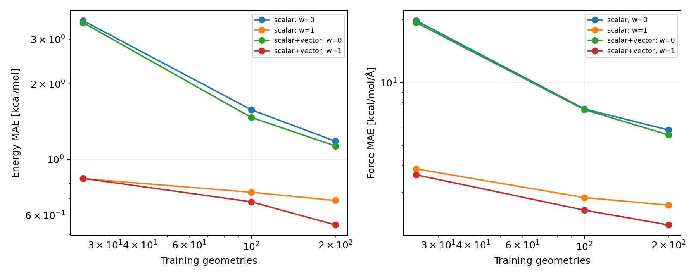
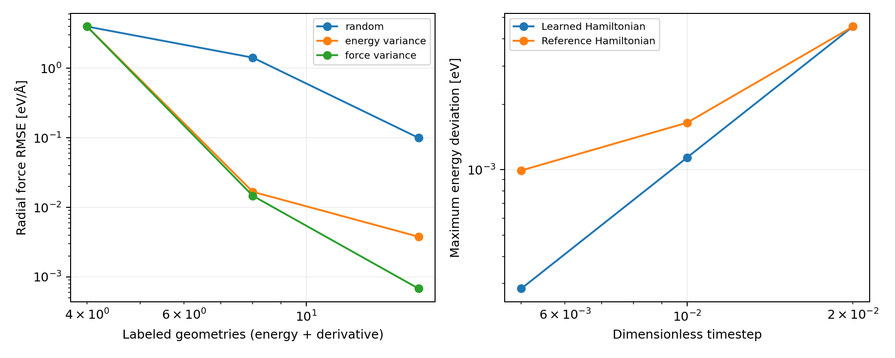

# Abstract

We investigate which physical constraints improve learned potential energy surfaces and which failures remain after those constraints are satisfied. A reproducible implementation using NumPy and SciPy progresses from a synthetic diatomic Morse potential to three-atom models and the real rMD17 ethanol dataset. Models include polynomial and radial-basis regression, a manually differentiated multilayer perceptron, a physics-prior residual model, Gaussian derivative kernels, hand-built invariant descriptors, and a compact trainable scalar/vector network. All force predictions derive from a scalar energy. On a fixed 300-geometry ethanol test set, a scalar/vector descriptor model trained on 200 geometries achieves energy and force mean absolute errors of 0.548 kcal mol$^{-1}$ and 2.091 kcal mol$^{-1}$ Å$^{-1}$, respectively. The scalar-only counterpart gives 0.686 and 2.601. Force supervision improves interpolation markedly, but does not prevent catastrophic polynomial extrapolation or guarantee that a physics-prior residual model improves every region. An uncertainty-guided diatomic acquisition experiment substantially outperforms random selection within its prescribed domain. A velocity-Verlet test distinguishes conservation of the learned Hamiltonian from fidelity to the reference Hamiltonian. These experiments support conservative, symmetry-aware modelling as a foundation rather than a sufficient criterion for molecular reliability. The hydrogen surfaces are synthetic, the kernel comparator is not an exact FCHL19 reproduction, and the small real-data study does not establish state-of-the-art performance.

# 1. Introduction

A molecular potential is more than a regression function with a low average error. Its derivatives determine trajectories, local curvature determines vibrational response, its asymptotes determine dissociation, and its symmetry determines whether arbitrary choices of origin, frame, or atom ordering affect a prediction. An energy model can interpolate accurately while failing any of these tests outside its training support. The central question of this report is therefore not whether an expressive model can fit a simple curve, but what each layer of physical structure actually buys.

The project begins with Filippo Vicentini's suggestion to learn an energy from nuclear charges and positions, obtain forces through differentiation, and begin with hydrogen before moving to molecular data [1]. We follow that progression while separating three distinct achievements: learning a prescribed analytic surface, constructing the correct transformation laws, and predicting electronic-structure reference data. Success at one does not establish success at the next.

The earlier project history recovered for this study included discussions of an H$_2$ Morse benchmark, polynomial/MLP/hybrid models, joint energy–force supervision, and region-based extrapolation tests. Some numerical summaries survived, but the corresponding source code and complete experimental protocols were not recovered. A later assistant-generated claim of percentage improvements was also found. None of these historical numbers is used as evidence here. All numerical experimental results in this report come from newly executed scripts supplied with the report.

The work makes four concrete contributions at the scale of a computational research study. First, it reconstructs a transparent energy–force learning pipeline without a high-level neural-network or atomistic-modelling framework. Second, it measures the gains and limits of derivative observations across synthetic and molecular tasks. Third, it builds both fixed equivariant features and a small trainable equivariant network, making their distinction explicit. Fourth, it evaluates failure modes that a single interpolation metric obscures: short-range instability, poor asymptotes, timestep versus model error, force-label redundancy, and non-identifiability across disconnected regions of configuration space.

# 2. Background and related work

## 2.1 Conservative learning and derivative observations

The target mapping is

$$E_\theta=E_\theta(Z,R),\qquad F_{i\alpha}=-\frac{\partial E_\theta}{\partial R_{i\alpha}}.$$

The minus sign is essential. The initial email's informal derivative expression is interpreted with this standard force convention. Learning a common scalar potential couples energy and force predictions and excludes arbitrary nonconservative force components. Gradient-domain molecular learning provides an established example of this construction [4]. Conservative forces nevertheless generate the dynamics of the learned potential, which can differ from the reference surface.

Christensen and von Lilienfeld study energy-only, force-only, and joint regression using derivative kernels [2]. Their molecular implementation uses FCHL19 local environments; their analysis motivates comparing supervision types within a common representation. Here we implement the derivative-observation algebra directly but use deliberately simpler representations. Accordingly, the results test the methodological principle rather than reproduce the published molecular benchmark.

## 2.2 Invariance, equivariance, and body order

For an orthogonal transformation $Q$ and translation $t$, a scalar potential should obey

$$E(Z,RQ+t)=E(Z,R),\qquad F(Z,RQ+t)=F(Z,R)Q.$$

Permuting positions and charges together should leave the energy unchanged and permute the forces accordingly. The relevant permutation symmetry includes exchange of chemically identical atoms without changing species assignments. Pair distances provide translation and rotation invariance, but a vector of distances stored in a fixed atom order does not automatically provide permutation invariance.

Scalar density sums provide a simple invariant representation. Vector density sums preserve directional information until invariant contractions are taken. This scalar/vector strategy is related in spirit to equivariant message passing, including PaiNN [5], but the present network is a much smaller independently implemented model, without a claim of architectural equivalence or comparable accuracy. Systematic invariant polynomial constructions and their relation to body order are developed in the atomic cluster expansion literature [6,7]. The descriptors used here form a restricted, incomplete subset of that general design space.

## 2.3 What the hydrogen task does and does not model

The diatomic reference is an analytic Morse curve with declared parameters; it is not newly computed electronic-structure data. Likewise, the H$_3$ reference below is a constructed three-body surface, not the physical neutral-hydrogen ground-state potential. This distinction prevents an implementation exercise from being mistaken for a reaction-chemistry result.

An isolated pair of atoms on a time-independent conservative potential also does not generically form a permanently bound molecule from a scattering state. Energy must leave the relative motion, for example through radiation or a third body. Our diatomic task learns a bound-state potential and tests its mechanics. It does not simulate the dissipative or radiative formation process, electronic transitions, or quantum nuclear dynamics.

# 3. Methods

## 3.1 Implementation and numerical differentiation

The supplied implementation uses NumPy for arrays, SciPy for linear algebra and optimization, and Matplotlib for figures. No JAX, PyTorch, e3x, e3nn, ASE, NetKet, or quantum-chemistry package is used in the experiments. The radial MLP has hand-derived parameter and mixed coordinate–parameter derivatives. Linear models use differentiated basis functions. For smooth many-atom energy features, coordinate derivatives are evaluated by complex-step differentiation:

$$\frac{\partial E}{\partial x}=\frac{\operatorname{Im}E(x+ih)}{h}+O(h^2),\qquad h=10^{-25}.$$

All relevant computational paths avoid absolute values, conjugation, distance sorting, and coordinate-dependent branches that would invalidate this analytic continuation. Distances are calculated as $\sqrt{\sum_\alpha d_\alpha^2}$, not a conjugating complex norm. Vector contractions are bilinear. The expressions are smooth for noncolliding real configurations. Independent central finite-difference tests check the resulting force implementation.

Complex-step differentiation is an implementation choice, not an efficient substitute for reverse-mode differentiation at large molecular scale. It requires one perturbed energy/feature evaluation per coordinate. The small fully trainable H$_3$ network uses complex-step coordinate derivatives and finite-difference parameter gradients inside L-BFGS-B. This makes the construction auditable, but limits its computational scalability.

## 3.2 Synthetic H$_2$ reference and partitions

The prescribed energy is

$$E_*(r)=D_e(q^2-2q),\qquad q=e^{-a(r-r_e)},$$

with $D_e=4.75$ eV, $a=1.8$ Å$^{-1}$, and $r_e=0.74$ Å. These are benchmark constants, not parameters estimated from experimental hydrogen spectroscopy. The energy tends to zero at infinite separation. Its radial derivative is

$$g_*(r)=E_*'(r)=2aD_e(q-q^2).$$

For $r=\|R_2-R_1\|$ and $u=(R_2-R_1)/r$, the Cartesian forces are $F_1=g_*u$ and $F_2=-g_*u$. The radial force is $-g_*$. Tables report the RMSE of $g$; its error equals that of the signed radial force, but is not a randomly oriented Cartesian component RMSE.

Training distances are independent uniform samples from $[0.55,1.60]$ Å, at sizes 8, 16, and 32 and seeds 0, 1, and 2. Evaluation uses a fixed 700-point grid on $[0.35,3.50]$ Å. It is partitioned into short-range extrapolation, the nominal training interval, and long-range extrapolation. Even the nominal interval can include distances outside the finite sample's extrema, so its label “ID” refers to the sampling domain rather than strict interpolation between observed endpoints.

## 3.3 Polynomial, radial-basis, neural, and hybrid potentials

The polynomial basis contains degrees 0 through 9 in $x=(r-1.1)/0.7$. The RBF basis contains a constant and 30 Gaussians with centers uniformly spaced from 0.4 to 2.4 Å and width 0.15 Å. Linear coefficients minimize

$$\mathcal L=\frac{1}{n}\|\Phi a-E\|^2+\frac{w}{n_F}\|Da-F\|^2+\lambda\|a\|^2,$$

where $D$ is the force basis for Cartesian problems and the radial derivative basis for H$_2$. The code preserves the corresponding target sign in each case. Linear H$_2$ fits use $\lambda=10^{-8}$. Rather than explicitly inverting normal equations, we solve an augmented least-squares problem.

The MLP is

$$E_\theta(r)=\sum_{k=1}^{24}c_k\tanh(a_kx+b_k)+d.$$

It has 73 parameters. Both $E$ and $g$ and their derivatives with respect to all parameters are implemented directly. Its joint objective uses the same mean energy and mean derivative errors plus $10^{-7}\|\theta\|^2$. L-BFGS-B is limited to 1,500 iterations. We retain and report termination statuses instead of discarding unsuccessful runs.

The hybrid adds this MLP to a deliberately imperfect fixed Morse prior with $D_0=4$ eV, $a_0=1.5$ Å$^{-1}$, and $r_0=0.8$ Å. Training fits the residual energies and derivatives. Because this prior belongs to the same functional family as the synthetic truth, any improvement is an in-family inductive-bias demonstration. Moreover, the unrestricted tanh residual can approach an arbitrary constant and does not enforce the exact dissociation energy.

## 3.4 Derivative-kernel regression

For a Gaussian kernel $k(x,y)=\exp[-\|x-y\|^2/(2\ell^2)]$, define the observation operator $L=(I,-\nabla_R)$. The joint covariance is

$$K_{EF}=\begin{pmatrix}k&-\partial_{R'}k\\-\partial_Rk&\partial_R\partial_{R'}k\end{pmatrix}.$$

The fitted coefficients satisfy $(K_{EF}+\lambda I)\alpha=y$, and query predictions use the same differentiated kernels. In the diatomic implementation the derivative target is $g=E'$, so the corresponding blocks use positive derivative operators instead. This change of convention is explicit in the two code paths.

For H$_2$, $x=r$, $\ell=0.35$ Å, and $\lambda=10^{-8}$. For ethanol, $x$ is the vector of all 36 inverse pair distances in fixed atom order. Coordinate derivatives follow by the chain rule. This descriptor is translation/rotation invariant but does not explicitly symmetrize identical atoms. Energy-only and joint models use 25 or 50 training geometries. Kernel lengths are selected from $\{0.25,0.5,1,2,4,8\}$ in inverse-distance descriptor units and regularization from $\{10^{-8},10^{-5},10^{-3}\}$ using validation data. These dimensionful choices define the numerical convention; they are not universal settings.

This baseline is computationally small but illustrates a central cost: the joint system has $n(1+3N)$ observations, not $n$. Dense storage and factorization scale quadratically and cubically in that count. Its fixed-order representation and restricted hyperparameter search preclude interpreting it as a competitive reproduction of FCHL19 or sGDML.

## 3.5 Hand-built scalar and vector descriptors

For each atom $i$, neighboring species $z$, and one of eight radial centers $c_k\in[0.6,4.0]$ Å, define

$$\rho_{izk}=\sum_{j\ne i;Z_j=z}e^{-[(r_{ij}-c_k)/0.6]^2},$$

$$v_{izk}=\sum_{j\ne i;Z_j=z}e^{-[(r_{ij}-c_k)/0.6]^2}\hat r_{ij}.$$

The scalar density is invariant and $v$ is a polar vector. We concatenate the species/radial channels. For each central species, we sum all scalar first-order channels and all quadratic scalar products $\rho_a\rho_b$, $a\le b$. The vector extension adds $v_a\cdot v_b$ for equal and adjacent channel indices. The final energy is linear in these pooled features. Thus the vector model contains equivariant intermediate features with a trained invariant linear readout; it is not an end-to-end neural network.

For ethanol there are 24 neighbor channels. The scalar model has $1+3(24+300)=973$ features. The vector extension adds $3(47)=141$ features, giving 1,114. The central-species grouping and neighbor sums ensure permutation symmetry. All pairs participate; the Gaussian functions decay smoothly, but there is no exact finite cutoff. This limits scaling and provides no rigorous separation into noninteracting fragments at finite distance.

Features are centered and standardized using training geometries only, with the constant feature preserved. Mean training energy is removed and restored. Force derivatives are divided by the same feature scales; centering does not affect them. Fits select $\lambda\in\{10^{-6},10^{-3},1\}$ by validation. We examine numerical force weights $w=0,1,100$. In physical units, weights multiplying force MSE relative to energy MSE carry squared-length units; quoted values refer to energies in kcal/mol and positions in Å. The validation score uses mean squared energy error plus mean squared force-component error in that fixed convention. It is a reproducible compromise, not a dimensionless or statistically calibrated likelihood.

## 3.6 A trainable scalar/vector H$_3$ network

A separate 19-parameter network uses three radial channels with learned centers and positive widths:

$$g_k(r)=e^{-\beta_k(r-c_k)^2},\quad s_{ik}=\sum_{j\ne i}g_k(r_{ij}),\quad v_{ik}=\sum_{j\ne i}g_k(r_{ij})\hat r_{ij},$$

$$E_\theta(R)=d+\sum_{i,k}o_k\tanh\left(a_ks_{ik}+b_k\,v_{ik}\cdot v_{ik}+h_k\right).$$

Here $\beta_k=e^{\eta_k}$. Centers, log-widths, scalar/vector gates, biases, output weights, and global offset are optimized. This is a one-layer equivariant aggregation followed by invariant nonlinear readout, not a deep message-passing model. It is permutation invariant for homogeneous H$_3$, and its differentiated forces are equivariant. Its homonuclear implementation has no learned species embedding and is not presented as transferable across elements.

# 4. Experimental design

## 4.1 Synthetic three-atom experiments

Both H$_3$ tasks use the constructed target

$$E_*(R)=\sum_{i<j}E_{\rm Morse}(r_{ij})+2\,e^{-1.2(r_{12}+r_{13}+r_{23})}.$$

The last term introduces a genuine nonadditive three-body dependence. Units follow the synthetic eV/Å convention. One stress dataset contains 260 randomly perturbed three-atom configurations, with 100 training and 160 testing geometries; it compares fixed scalar and vector descriptors. A separate bounded-triangle dataset contains 150 geometries generated from two sides in $[0.8,1.6]$ Å and an included angle in $[0.7,2.3]$ radians, with 60 training and 90 testing geometries; it tests the trainable network. The third side is determined geometrically and is not independently bounded to the same interval.

The two H$_3$ datasets differ and their errors must not be ranked against each other. The stress sample can contain relatively close approaches. Neither task has reference quantum chemistry, an electronic spin specification, or the conical-intersection structure required for a realistic reactive H$_3$ study.

## 4.2 Real molecular reference data

We downloaded the standalone rMD17 ethanol archive from the dataset repository [3]. It contains 100,000 geometries, nine atoms, and revised energies and Cartesian forces. We use `coords`, `nuclear_charges`, `energies`, and `forces`, never the `old_energies` or `old_forces` arrays. The accompanying readme specifies Å, kcal/mol, and kcal/mol/Å, respectively, and identifies the revised electronic-structure calculations as PBE/def2-SVP with stringent numerical settings. The repository also warns that trajectory-derived configurations are not independent samples [3].

A permutation of the 100,000 archive indices, with NumPy seed 42, provides 200 candidate training geometries, 100 validation geometries, and 300 test geometries. Training subsets of 25, 100, and 200 are nested. The kernel comparator uses the first 25 or 50 of the same candidate training indices and exactly the same validation/test indices. These are custom splits, not the repository's official benchmark splits. The validation set supplies additional supervision for model selection and must be counted when discussing an overall data budget.

To assess one source of temporal optimism, a second experiment sorts geometries by `old_indices`, which records their original trajectory indices. It samples 200 training geometries from the earliest 70%, 100 validation geometries from the following 10%, and 300 test geometries from the final 20%, using seed 43. No labels from the held-out final block enter model selection. This split reduces direct temporal interleaving but does not guarantee independent conformational basins or an out-of-equilibrium test distribution.

## 4.3 Acquisition, uncertainty, and dynamics

The active-selection task uses an unlabeled pool of 180 equally spaced H$_2$ distances on $[0.35,2]$ Å. Every queried geometry supplies both energy and derivative. Starting from four random geometries, a joint Gaussian model adds the candidate with maximal posterior energy variance or maximal posterior derivative variance. Random selection is the control. Budgets are 4, 8, and 16 geometries over three initial seeds. Predictions are scored on a separate 500-point grid over the same interval. Thus the task measures support coverage within a known one-dimensional domain, not extrapolation to unknown chemistry.

A separate 12-member RBF ensemble is formed by independently sampling 16 training distances in the original H$_2$ domain. Its pointwise energy standard deviation is compared with mean-prediction error. This is an uncertainty diagnostic rather than calibrated posterior inference: independently resampled training sets are not a principled posterior distribution over model misspecification.

For dynamics, a joint derivative-kernel potential is trained on 32 evenly spaced distances in the H$_2$ training interval. We integrate one-dimensional radial motion from $r=1.2$ Å and zero velocity using velocity Verlet, unit reduced mass, and timesteps 0.02, 0.01, and 0.005 over numerical duration 20. Time is nondimensionalized; the values are not femtoseconds. We monitor both the learned Hamiltonian and the reference Hamiltonian along the learned trajectory. This is a controlled bound-motion diagnostic, not molecular production MD or a formation simulation.

# 5. Results

## 5.1 Derivative labels improve local accuracy without fixing extrapolation

Table 1 reports results with 32 training geometries and joint supervision. Values are means over three independent training sets; the full per-seed records and energy-only comparisons are included in `results.json`. Neural results include optimization-limited fits.

\needspace{12\baselineskip}

**Table 1. H$_2$ mean RMSE with energy–derivative training.** Energy is in eV; derivatives are in eV/Å. The last two columns isolate extrapolation.

|Model|ID energy|ID derivative|Short derivative|Long derivative|
|---|---|---|---|---|
|poly|7.595e-07|2.41e-05|0.01277|534.2|
|rbf|0.0001454|0.008133|6.184|3.241|
|kernel|4.086e-05|0.001817|1.473|0.7047|
|MLP|0.0001674|0.007157|4.804|0.154|
|hybrid|7.151e-05|0.002548|1.535|0.2047|

The degree-nine polynomial provides the smallest in-domain error but develops a long-range derivative RMSE exceeding 500 eV/Å. This is a decisive counterexample to interpreting local derivative accuracy as a stability certificate. Joint fitting constrains slopes at sampled distances; it does not constrain polynomial growth outside the sample interval.

For the Gaussian kernel, adding derivatives reduces the mean in-domain energy RMSE from $5.06\times10^{-4}$ to $4.09\times10^{-5}$ eV and derivative RMSE from 0.0252 to 0.00182 eV/Å. Its long-range derivative error nevertheless changes from 0.678 to 0.705 eV/Å. The RBF model exhibits a sharper trade-off: in-domain derivative error improves from 0.0692 to 0.00813, while long-range derivative error worsens from 0.645 to 3.24. These results are conditional on the specified basis, regularization, and sampling distribution.

A matched scalar-label-count comparison is less decisive than a matched-geometry comparison. For the kernel, eight jointly labeled geometries provide 16 scalar observations and yield ID energy/derivative RMSEs of 0.00404/0.0929; 16 energy-only geometries provide the same scalar count and yield 0.00365/0.0871. At 32 scalar observations, 16 joint geometries give 0.000790/0.0178, while 32 energy-only geometries give 0.000506/0.0252. Derivative supervision can improve force accuracy without uniformly improving energy accuracy at matched scalar count. Scalar counts still omit correlations and the actual cost of obtaining labels.

The hybrid substantially improves the repulsive region relative to the pure joint MLP: short-range derivative RMSE decreases from 4.80 to 1.54 eV/Å. Long-range derivative RMSE, however, increases from 0.154 to 0.205. Its mean long-range energy RMSE changes only modestly, from 0.135 to 0.128 eV, with substantial seed variation. The earlier historical percentage-improvement claim therefore cannot be carried into this experiment. A physics-motivated prior helps where it captures relevant structure; unrestricted residuals do not inherit every desirable property of that prior.

Seven of the twelve radial MLP/hybrid fits reached the 1,500-iteration limit without a success termination. The retained values describe these finite optimization budgets, not fully converged model classes. For the joint MLP, the long-range derivative RMSE has seed standard deviation 0.0216 eV/Å; for the hybrid it is 0.0817. These are population standard deviations across only three runs, not confidence intervals. More repetitions and optimization controls are necessary before estimating a reliable hybrid advantage.

{width=95%}

## 5.2 Three atoms: directional structure helps conditionally

On the stress H$_3$ task, the scalar and scalar/vector linear models have energy RMSEs 0.0883 and 0.1009 eV, respectively, and Cartesian force-component RMSEs 0.4078 and 0.4022 eV/Å. The vector channels slightly reduce force RMSE but worsen energy error. More features therefore do not uniformly improve a fixed small-data problem; regularization and support matter. This two-model result is a useful negative control against presenting angular information as an automatic accuracy gain.

On the separate bounded-triangle task, the fully trainable 19-parameter network achieves the following errors.

\needspace{12\baselineskip}

**Table 2. Trainable scalar/vector network on synthetic H$_3$.** One run per supervision setting; 60 training and 90 test geometries.

|Supervision|Energy RMSE (eV)|Force RMSE (eV/Å)|Termination|
|---|---|---|---|
|E only|0.06281|0.347|400 iterations|
|E + F|0.02173|0.1585|400 iterations|

Both fits reached the optimization limit. The two supervision settings use identical initial parameters, so initialization is controlled within this pair. The result establishes a functioning trainable equivariant construction and suggests a useful supervision effect, but a single paired run does not establish its stability across initializations. Rotation and permutation checks for its retained joint-fit parameters agree to approximately $10^{-15}$ in the tested configuration.

## 5.3 Ethanol: force supervision and vector contractions

Table 3 summarizes the random-split real-data experiment. All errors use revised DFT labels. “Scalar/vector” refers to a linear model of symmetry-aware features, not the small H$_3$ neural network.

\needspace{12\baselineskip}

**Table 3. Ethanol mean absolute errors on 300 fixed test geometries.** Energy: kcal/mol. Force components: kcal/mol/Å. Each row has validation-selected regularization.

|Train|Features|Labels|Energy MAE|Force MAE|
|---|---|---|---|---|
|25|Scalar|E|3.565|19.75|
|25|Scalar|E + F|0.8379|3.873|
|25|Scalar/vector|E|3.498|19.35|
|25|Scalar/vector|E + F|0.8399|3.627|
|100|Scalar|E|1.575|7.489|
|100|Scalar|E + F|0.7397|2.825|
|100|Scalar/vector|E|1.469|7.429|
|100|Scalar/vector|E + F|0.6776|2.46|
|200|Scalar|E|1.181|5.939|
|200|Scalar|E + F|0.6856|2.601|
|200|Scalar/vector|E|1.131|5.629|
|200|Scalar/vector|E + F|0.5481|2.091|

With 200 geometries, force supervision lowers scalar-model force MAE from 5.94 to 2.60 kcal/mol/Å, and scalar/vector force MAE from 5.63 to 2.09. At the same joint-supervision setting, vector contractions improve energy MAE by about 20% and force MAE by about 20% relative to the scalar descriptor model. Because the vector model adds 141 features, these results confound directional content with feature count and effective capacity; a matched-capacity ablation remains necessary.

Increasing the vector-model numerical force weight from 1 to 100 at 200 training geometries changes force MAE only from 2.091 to 2.071, while worsening energy MAE from 0.548 to 0.678 kcal/mol. Thus “more force weight” is not an unqualified improvement. Weight selection should follow the intended observable and its physical error budget, rather than the assumption that force labels must dominate.

On the chronological split, the joint scalar/vector model gives energy MAE 0.613 kcal/mol and force MAE 2.253 kcal/mol/Å, with RMSEs 0.806 and 3.236. The selected regularization is $10^{-3}$, compared with $10^{-6}$ for the corresponding random-split model. The modest deterioration is encouraging but does not demonstrate broad extrapolation: both splits originate in the same ethanol trajectory. There is only one chronological split and one random split.

{width=95%}

## 5.4 Comparison with a non-neural derivative-kernel baseline

\needspace{12\baselineskip}

**Table 4. Fixed-order inverse-distance Gaussian kernel on ethanol.** Errors are MAEs on the same test set as Table 3, with the same revised labels.

|Train|Labels|Energy MAE|Force MAE|Length|Ridge|
|---|---|---|---|---|---|
|25|E|4.072|20.36|8.0|0.001|
|25|EF|2.119|6.492|8.0|1e-08|
|50|E|4.035|20|0.25|0.001|
|50|EF|0.9313|2.804|8.0|1e-08|

Derivative observations strongly improve this baseline. With 50 training geometries, force MAE decreases from 20.00 to 2.80 kcal/mol/Å, and energy MAE decreases from 4.04 to 0.931 kcal/mol. This is qualitatively consistent with the benefit of derivative observations investigated in [2], but the numbers cannot be compared with the paper's FCHL19 results: the representation, splits, training sizes, and search differ.

The joint kernel chooses the largest tested length, 8, and smallest tested ridge, $10^{-8}$, at both training sizes. Its optimum is therefore not bracketed by this search. This is an explicit tuning limitation. The joint system has 1,400 observations at 50 geometries, despite only 50 structures. At 25 geometries, the scalar/vector feature model and kernel have different effective dimensions and different regularization mechanisms, so their comparison is an operational baseline rather than a controlled test of linear versus kernel expressivity.

## 5.5 Structural and differential checks

For a representative ethanol scalar/vector model, translation/rotation and permutation energy changes round to zero at the printed double-precision energy scale. Force covariance errors are $3.66\times10^{-13}$ and $1.35\times10^{-13}$ kcal/mol/Å, respectively. Maximum residual net force is $2.81\times10^{-13}$ kcal/mol/Å, and residual torque is $6.09\times10^{-13}$ kcal/mol in the evaluated frames. These are numerical checks on a few configurations, not exhaustive formal verification; the transformation laws also follow algebraically from the construction.

A central finite-difference force check differs from the complex-step feature force by $8.25\times10^{-8}$ kcal/mol/Å. The molecular derivative-kernel force check differs by
0.0137 kcal/mol/Å. The hand-derived radial MLP energy and mixed-derivative Jacobians agree with parameter finite differences to $3.33\times10^{-11}$ in the selected test. The absolute errors depend on differencing steps, energy offsets, and numerical conditioning; they are reported as implementation diagnostics rather than general accuracy bounds.

For five ethanol geometries, the $27\times1114$ force-feature Jacobian has numerical rank 21 at tolerance $10^{-7}$. This equals $3N-6$ for a generic nonlinear nine-atom molecule. Translation and rotation remove six independent rigid-motion directions. Consequently, the 27 Cartesian force numbers at a geometry cannot be interpreted as 27 independent internal geometric measurements. This does not make any individual force component dispensable in a noisy fit, but it matters when describing information gain per label.

## 5.6 Uncertainty-guided selection and uncertainty limits

\needspace{12\baselineskip}

**Table 5. H$_2$ acquisition results: mean derivative RMSE over three seeds, eV/Å.** Every selected geometry provides energy and derivative labels.

|Geometries|Random|Energy variance|Derivative variance|
|---|---|---|---|
|4|3.968|3.968|3.968|
|8|1.418|0.01673|0.01465|
|16|0.09957|0.003781|0.0006796|

At 16 geometries, derivative-variance acquisition has mean derivative RMSE $6.80\times10^{-4}$ eV/Å, compared with $9.96\times10^{-2}$ for random selection. The ratio of means is approximately 147. This large difference belongs to a deliberately favorable low-dimensional task with a known bounded candidate pool, analytic noise-free labels, and a fixed smoothness model. It is evidence for efficient placement of derivative observations in this task, not evidence for a 147-fold reduction in electronic-structure cost for realistic molecules.

The RBF ensemble gives a Spearman correlation of 0.881 between standard deviation and absolute mean energy error within the nominal H$_2$ training interval. At 3.5 Å, its standard deviation is 1.60 eV and mean-prediction absolute error is 1.25 eV. In that example the ensemble does express substantial uncertainty; a claim of falsely confident dissociation would be unsupported. No empirical coverage calibration, cross-architecture committee, or uncertainty evaluation on ethanol was performed.

## 5.7 Conservation of which Hamiltonian?

\needspace{12\baselineskip}

**Table 6. Bound radial dynamics: maximum absolute energy deviation over numerical duration 20, eV.** Unit reduced mass; timesteps are nondimensional.

|Timestep|Learned Hamiltonian|Reference Hamiltonian|
|---|---|---|
|0.02|0.00455|0.004548|
|0.01|0.001138|0.001645|
|0.005|0.0002846|0.0009927|

The learned-energy deviation decreases by approximately a factor of four whenever the timestep halves, consistent with the expected second-order behavior of velocity Verlet in this stable test. The reference-energy deviation does not follow that trend as closely. At the smallest timestep it remains about $9.93\times10^{-4}$ eV, compared with $2.85\times10^{-4}$ for the learned energy. Three timesteps do not establish a converged asymptotic plateau, but they demonstrate why the two diagnostics must be recorded separately.

A conservative model can conserve its own energy while accumulating reference trajectory error. Conversely, a good model can display numerical energy error if the timestep is too large for its stiffest sampled mode. The correct interpretation requires a timestep sweep and an independent reference evaluation, rather than a single “energy drift” score.

{width=95%}

# 6. Discussion and research directions

## 6.1 What deserves to be pursued next

The most productive next experiment is not a much larger model. It is a stronger falsification test of the present representation. The ethanol scalar/vector features already produce a measurable improvement, but the current dataset does not probe bond breaking, rare torsions systematically, changes of composition, or fragment separation. A paired design with matched feature counts, repeated splits, and a held-out torsional basin would resolve whether the improvement reflects useful angular structure or simply extra capacity.

A second priority is converting the current complex-step implementation into a small forward/reverse differentiation engine or a manually differentiated scalar/vector model. The scientific target is the same transformation law, but the computational cost matters once force training requires mixed derivatives over thousands of parameters. Using automatic differentiation at that stage would not invalidate a from-scratch architectural implementation; it would separate implementing the physics from reimplementing a numerical differentiation library. The present code deliberately takes the more transparent route only where the system size makes it practical.

Moving from H$_2$ to a physically realistic H$_3$ surface requires specifying the electronic state and reference method before fitting. Generic pairwise Morse interactions plus a symmetric three-body term are insufficient to reproduce hydrogen exchange chemistry. A defensible extension would begin with a small independently generated electronic-structure grid and a clearly bounded adiabatic domain, then examine electronic-state limitations before claiming reaction dynamics.

## 6.2 Unconventional proposal A: energy bridges for disconnected force support

This proposal is original to the present research plan; no claim of priority over the literature is made. Consider training support consisting of two disconnected regions. If $S(R)$ is smooth, equals zero on one region, and equals one on the other, then

$$E_2(R)=E_1(R)+C S(R)$$

has exactly the same forces as $E_1$ throughout both observed regions, while their relative energy is shifted by $C$. A one-dimensional construction can place the transition entirely in an unobserved gap between 1.0 and 1.5 Å. Choosing $C=2$ eV changes the relative offset by exactly 2 eV without changing a single observed force. This is an analytic identifiability example, not a fitted numerical result.

The practical implication is a basin graph: nodes represent well-sampled conformational regions and edges represent energy comparisons or connecting reference calculations. Force-dense sampling inside each basin cannot replace the missing edges. A targeted acquisition policy could spend energy evaluations on poorly connected basin pairs instead of repeatedly reducing local force uncertainty. The next test would create two ethanol torsional training basins, withhold connecting configurations, and compare force-rich local sampling against a few deliberately placed energy bridges. That molecular experiment has not been run.

## 6.3 Unconventional proposal B: rigid-mode-aware label accounting

A second proposal is to evaluate data efficiency by observably distinct internal directions rather than raw Cartesian component count. The measured rank-21 ethanol Jacobians motivate a projected force loss. Let $P_{\rm int}(R)$ project onto the complement of the rigid-motion tangent space. One could compare

$$\|P_{\rm int}(F_\theta-F_*)\|^2$$

with the usual component loss, while reporting any reference force in the rigid-motion subspace separately as a consistency diagnostic. Because the present model already predicts zero rigid force and torque, projection does not automatically create extra information or improve a noiseless fit. Its potential value is in noise-aware weighting, mixed-size datasets, and budget accounting. Linear molecules require the appropriate five-dimensional rigid-motion tangent space, not the generic nonlinear six-dimensional assumption.

A more ambitious acquisition criterion would maximize the increase in internal force-information rank or a regularized log determinant, normalized by reference-calculation cost. This would distinguish repeated information along a stiff bond mode from coverage of previously unobserved soft torsions. Only the rank diagnostic has been executed here; the projected-loss and molecular acquisition comparisons remain hypotheses.

## 6.4 Unconventional proposal C: adversarial tests of conservative models

A third proposed extension targets a failure that force-error averages can hide: locally plausible but systematically wrong conservative corrections. Choose a smooth perturbation $\delta E$ that is almost invisible on training configurations but alters a soft-mode barrier, fragment interaction, or transition region. Since $-\nabla(E+\delta E)$ remains conservative, zero curl and energy consistency cannot detect the failure.

An adversarial benchmark could search over low-norm perturbations in the model's weakly constrained feature subspace while bounding training residuals. The objective would maximize barrier changes or reference-Hamiltonian deviation on held-out trajectories. Comparing the attack against ensemble uncertainty would test whether model disagreement actually covers structurally allowed errors. This is a proposed falsification procedure, not a demonstrated novel algorithm. The observed polynomial blow-up and the learned/reference Hamiltonian gap motivate it, but do not themselves establish adversarial robustness results.

## 6.5 Hard constraints for a residual model

The hybrid result suggests replacing an unrestricted residual with a constrained one. For example,

$$E(r)=E_{\rm prior}(r)+s(r)u_\theta(r),$$

where $s$ and $s'$ vanish as $r\rightarrow\infty$, would preserve a prescribed dissociation energy and force asymptote if $u_\theta$ and its derivative remain suitably bounded. A short-range repulsive lower bound would need a separate construction; merely multiplying by a decaying envelope is insufficient near a collision. This extension is worth pursuing only with a prior family distinct from the synthetic reference and a test that penalizes incorrect asymptotic coefficients. Otherwise it risks rewarding recovery of a known generating formula rather than learning transferable physics.

# 7. Limitations

The principal limitation is scale and scope. The real-data study covers ethanol only, with at most 200 training geometries and a single random split plus one chronological split. Aspirin and paracetamol were identified in the repository but not trained or evaluated. No cross-molecule transfer, production molecular dynamics, molecular uncertainty calibration, reactive quantum chemistry, or electronic-structure calculation was executed. The diatomic MD test cannot substitute for an ethanol trajectory test.

Optimization is another substantive limitation. Seven radial neural fits and both small H$_3$ network fits reached their iteration limits. The H$_3$ supervision comparison uses a shared initialization but lacks repeated seeds. The linear fits are reproducible solutions of their regularized objectives, but feature standardization and the selected ridge strength affect their effective complexity. Extra vector channels do not form a matched-capacity ablation.

The kernel baseline faithfully differentiates a scalar covariance, but it does not implement FCHL19, local atomic kernels, or full identical-atom symmetrization. Its preferred joint-kernel length is at the search boundary. It is a methodological comparator rather than an optimized reference method. Error comparisons with published rMD17 benchmark tables would be inappropriate on the custom splits used here.

The uncertainty and acquisition results concern a one-dimensional analytic target with a known pool and smooth fixed kernel. No general coverage guarantee follows. Molecular active learning must additionally confront basin discovery, changing topology, reference-method failure, and correlated trajectory sampling. The derivative kernel's mathematical posterior variance expresses uncertainty under its assumed covariance and numerical regularization; it is not a detector of every plausible electronic-structure or representation error.

Finally, conservative forces do not ensure correct reference dynamics. The report tests local symmetry and differential identities and a short bound-motion integration, but does not test long-time statistical ensembles, vibrational spectra, rare-event rates, or robustness at collisions. Those observables require their own physical reference and convergence studies.

# 8. Conclusion

A small from-scratch implementation is sufficient to expose several central issues in molecular potential learning. Energy-derived forces enforce an important consistency condition, and derivative observations substantially improve local predictions in both synthetic and ethanol tasks. Directional intermediate features improve the tested ethanol descriptor model, while a compact trainable scalar/vector network verifies that equivariant aggregation can be implemented without a specialized architecture library.

The same experiments show the boundary of these successes. Excellent interpolation coexists with disastrous polynomial extrapolation. A physics-prior hybrid improves the repulsive region without uniformly improving dissociation-region forces. Finite-budget neural optimization remains incomplete. Conservation of a learned Hamiltonian does not establish fidelity to the reference Hamiltonian. Uncertainty-guided acquisition is effective on the controlled diatomic task, but its molecular value remains to be tested.

The strongest next research direction is therefore a deliberate study of identifiability and support: matched-capacity angular ablations, disconnected-basin energy bridges, internal-direction information accounting, and conservative adversarial perturbations. These questions can produce meaningful results before scaling to larger molecules or architectures, because they ask which errors the available data can actually rule out.

# References

1. E3x documentation. *Training a neural network potential on MD17 ethanol*, version 1.0.1. https://e3x.readthedocs.io/v1.0.1/examples/md17_ethanol.html. Accessed for this study. The project email is personal communication and is not an independently published source.
2. A. S. Christensen and O. A. von Lilienfeld. *On the role of gradients for machine learning of molecular energies and forces*. arXiv:2007.09593 (2020). https://arxiv.org/abs/2007.09593.
3. A. S. Christensen and O. A. von Lilienfeld. *Revised MD17 dataset (rMD17)*. Figshare, dataset 12672038, including the standalone ethanol archive and `readme.txt`. https://figshare.com/articles/dataset/Revised_MD17_dataset_rMD17_/12672038.
4. S. Chmiela, A. Tkatchenko, H. E. Sauceda, I. Poltavsky, K. T. Schütt, and K.-R. Müller. *Machine learning of accurate energy-conserving molecular force fields*. Science Advances **3**, e1603015 (2017). https://doi.org/10.1126/sciadv.1603015. Preprint: https://arxiv.org/abs/1611.04678.
5. K. T. Schütt, O. T. Unke, and M. Gastegger. *Equivariant message passing for the prediction of tensorial properties and molecular spectra*. ICML (2021); arXiv:2102.03150. https://arxiv.org/abs/2102.03150.
6. R. Drautz. *Atomic cluster expansion for accurate and transferable interatomic potentials*. Physical Review B **99**, 014104 (2019). https://doi.org/10.1103/PhysRevB.99.014104.
7. G. Dusson, M. Bachmayr, G. Csányi, R. Drautz, S. Etter, C. van der Oord, and C. Ortner. *Atomic Cluster Expansion: Completeness, Efficiency and Stability*. arXiv:1911.03550. https://arxiv.org/abs/1911.03550.

# Appendix A. Derivative-kernel formulas

Let $q=q(R)$, $q'=q(R')$, $\Delta=q-q'$, and $J=\partial q/\partial R$. For $k=\exp[-\Delta^T\Delta/(2\ell^2)]$,

$$K_{FE}=\frac{k}{\ell^2}J^T\Delta,\qquad K_{EF}=-\frac{k}{\ell^2}\Delta^T J',$$

$$K_{FF}=k\left[\frac{J^T J'}{\ell^2}-\frac{(J^T\Delta)(\Delta^T J')}{\ell^4}\right].$$

There is no second derivative of $q$ in this cross-geometry covariance block: the derivatives act once on each of two independent configurations. For inverse distances,

$$\frac{\partial r_{ij}^{-1}}{\partial R_i}=-\frac{R_i-R_j}{r_{ij}^3},\qquad \frac{\partial r_{ij}^{-1}}{\partial R_j}=+\frac{R_i-R_j}{r_{ij}^3}.$$

The implementation assembles energies first, followed by flattened force observations. Query force rows use the same convention. These signs are independently checked by differentiating the resulting predicted scalar energy.

# Appendix B. Manual mixed derivatives for the radial MLP

Set $t_k=\tanh(a_kx+b_k)$ and $s_k=1-t_k^2$. Then

$$E=\sum_k c_kt_k+d,\qquad g=\frac{1}{0.7}\sum_k c_ka_ks_k.$$

For the joint loss, the nontrivial mixed derivatives are

$$\frac{\partial g}{\partial a_k}=\frac{c_ks_k}{0.7}(1-2t_ka_kx),\quad
\frac{\partial g}{\partial b_k}=-\frac{2c_ka_ks_kt_k}{0.7},\quad
\frac{\partial g}{\partial c_k}=\frac{a_ks_k}{0.7},\quad
\frac{\partial g}{\partial d}=0.$$

These expressions allow joint energy–derivative training without an automatic-differentiation package. Parameter ordering and all objective normalizations are recorded in the code.

# Appendix C. Reproducibility and provenance

The archive contains the scripts `experiments.py`, `extensions.py`, `diagnostics.py`, and `make_figures.py`; full result JSON files; exact random and chronological split arrays; environment versions; and run logs including optimizer statuses. `download_data.py` retrieves the external ethanol archive and verifies its SHA-256 hash. The original 65 MB dataset is not redistributed. Run all scripts with one BLAS thread for the recorded resource convention. The principal scripts completed on CPU in tens of seconds each; these are small experiments, not a large training campaign. The refinement log records the expanded kernel search used in Table 4; `h3_controlled.log` records the matched-initialization neural comparison and supersedes the initial H$_3$ log.

The dataset hash is:

`0824d78c687b8ede25f7162c54c5c6434cfe37f9f859ee8f223c60379d7d5cf9`

The supplied environment uses Python 3.12.14, NumPy 2.3.5, and SciPy 1.17.0. Minor numerical differences across BLAS and platform versions are possible. Random generators and seeds are explicit. No recovered historical number contributes to the new result tables, and the report does not imply that Filippo Vicentini has reviewed or endorsed its conclusions.
